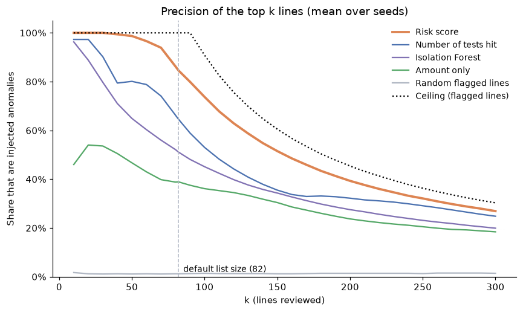
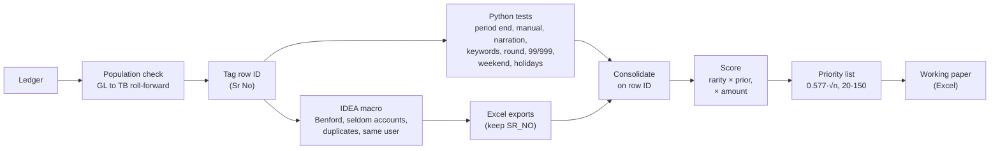

# gl-risk-scoring

[](https://github.com/luke-menezes/gl-risk-scoring/actions/workflows/tests.yml)

[](LICENSE)

**Helping auditors select journal entries for testing under ISA 240: ranked, with the reasons, on
synthetic general ledgers.**

ISA 240 presumes a risk that management overrides controls, for example through false journal
entries, so the auditor must test journal entries whatever their risk assessment. The standard lists
characteristics of entries worth selecting (manual entries, round numbers, seldom-used accounts,
entries with little or no description, and more), and requires selecting entries made at the end of
the period. Simple tests for those characteristics flag thousands of lines: on the synthetic ledgers
here, over a third of the lines meet at least one test. This project combines every test on a row
ID and ranks the lines with a transparent score, to help the auditor select, and shows why each line
is on the list. It supports the auditor's journal entry testing; it doesn't perform it. Selecting
entries and concluding on them stay with the audit team.

On synthetic ledgers, the top-82 list is «P_RISK_PCT» precise (± «P_RISK_SD_PTS» points over 30 seeds),
against «P_TESTS_PCT» for counting how many tests each line hits and «P_IF_PCT» for an Isolation Forest.

**Population first.** Ranking should wait until the population is confirmed complete. Per account,
the opening trial balance plus the ledger's movements must equal the closing trial balance;
`population.roll_forward` returns any difference, which is resolved before testing.



## Audit context

ISA 240 presumes a risk of management override of controls (ISA 240 para 31; ISA 240 (Revised)
para 40), so journal entries are tested whatever the assessed risk (240 para 32(a); 240R paras
47–49). ISA 240 (Revised) applies to periods beginning on or after 15 December 2026 (240R para 16).
The standards list characteristics of entries worth selecting (240 para A43; 240R Appendix 4) but
don't rank them or prescribe tests. Each test here looks for one characteristic or supports the
auditor in another way. "Practical judgement" marks a link that is my judgement rather than the
standard's. Every threshold, window and keyword list is practical judgement.

**Tests that answer a risk**: each lists entries the auditor can select from.

| Test | Characteristic it covers | ISA 240 / ISA 240 (Revised) | Auditor's use |
|---|---|---|---|
| Period end (quarter ends, year-end window) | Entries made at the end of the period | 240 paras 32(a)(ii), A44; 240R paras 49(c), A144 | Select |
| Manual entry | Non-standard and manual entries | 240 para A43; 240R para A144, Appendix 4. Manual as the main filter: practical judgement | Select; also limits the weekend, holiday and round-amount tests to manual lines |
| No or vague narration | Little or no explanation or description | 240 para A43; 240R Appendix 4 | Select |
| Seldom-used account | Entries to seldom-used accounts | 240 para A43; 240R Appendix 4. The 3-entry threshold: practical judgement | Select |
| Rounded amount | Round numbers | 240 para A43; 240R Appendix 4 | Select |
| Ending 99/999 | Consistent ending numbers | 240 para A43; 240R Appendix 4 | Select |
| Keyword match | Entries outside the normal process | 240 para A43; 240R Appendix 4: practical judgement, as is the word list | Select |
| Weekend posting | Outside the normal course of business | 240 para A43; 240R Appendix 4: practical judgement | Select |
| Public holiday | Outside the normal course of business | 240 para A43; 240R Appendix 4: practical judgement | Select |
| Created and approved by the same user | Controls over journal entries (segregation of duties). Whether it is a breach depends on roles and the approval workflow | ISA 315 (Revised 2019) para 26(a)(ii); 240R para 36, Appendix 4 | Select |
| Duplicate | Not an ISA 240 characteristic: a common error and fraud test | Practical judgement | Select |
| Benford entries (lines behind over-represented first digits) | Outliers found with automated tools | 240R para A145: practical judgement | Select |
| Priority list (the score) | A selection aid across the tests above | 240R paras 49(c)–(d), A145: practical judgement. Why each line was selected is documented (ISA 230 para 9) | Select |

**Tests that describe the ledger**: planning inputs, not findings.

| Test | What it shows | Reference | Auditor's use |
|---|---|---|---|
| Benford first-digit conformity (MAD) | Whole-ledger analytical screen. Non-conformity is expected where fixed fees or salaries repeat; a spike is a pointer for review, not evidence of error or fraud | ISA 315 para 14(b), A27–A31: practical judgement | Risk assessment input |
| Account summary | Lines and value per account | ISA 315 para 14(b): practical judgement | Risk assessment input |

**Population**

| Test | What it checks | Reference | Auditor's use |
|---|---|---|---|
| GL to TB roll-forward | Journal entry population complete for the period | ISA 500 para 9, A60; 240R paras 49(b), A140 | Population check, before any ranking |

The priority list is a selection of specific items, not audit sampling (ISA 500 para 10, A52–A56),
so nothing about the unlisted lines can be projected from it. Lines above performance materiality
(ISA 320 paras 10–11) can be added to it; nothing below clearly trivial (ISA 450 para 5, A2) is
filtered out of any test, because small or split entries can matter.

## Pipeline



## Key design decisions

- **One row ID, tagged before the split.** The ledger gets a running number (`Sr No`) before the
  same file goes to Caseware IDEA and to Python. Every IDEA export keeps it, so the results join
  exactly. A hash of the row wouldn't work: identical duplicate lines would share it. Matching on
  date, account and amount fails for the same reason. See [`idea/README.md`](idea/README.md).
- **Weight = ledger rarity × prior.** Rarity is `-log10(share of the ledger flagged)`, so a test
  that flags 0.2% of lines counts much more than one that flags 12%. The prior carries what the
  test has been worth across past ledgers; the values here are illustrative.
- **Correlated tests count once.** A Saturday that is also a public holiday, or falls in a
  period-end window, is one calendar signal, not two, so only the strongest date test counts for
  each line.
- **Manual lines only, where the ledger says which they are.** With a `Source` column, the weekend,
  holiday and round-amount tests count manual lines only, because system postings on a Saturday are
  routine. Without one, the manual-entry test doesn't run and the outputs say so: "manual" is never
  guessed.
- **Benford scaled by amount diversity.** In ledgers of fixed fees or salaries, non-conformity is
  expected and says little about any one line, so Benford's weight shrinks with the share of
  distinct amounts.
- **Amount as a log multiplier.** `1 + log10(1 + amount / median)`: large lines rise without a hard
  cut-off, and one rare characteristic on a very large entry can still make the list.
- **List size grows with √n.** `clip(0.577·√n, 20, 150)`: about 100 lines for a 30,000-line
  ledger, never more than a reviewer can work through.

**What the benchmark can and can't show.** «DESIGN_SUMMARY»

More detail in [`DESIGN.md`](DESIGN.md).

## Results on synthetic data

Each ledger has 20,000 lines with 0.5% injected anomalies, all with a larger amount. These labels
exist only in the synthetic data: a real ledger has none. Nine in ten anomalies carry one to four
signals, each a characteristic a test looks for; the other tenth are "silent", an unusual amount on
a common account on a weekday, from the system, with nothing for any test to find. Alongside them is
normal business that trips the tests anyway: round rent payments, director fees, a fixed-price
supplier, weekend postings, double postings, routine system accruals at quarter ends and system
lines with no description. The priority list is 82 lines. Figures are the mean ± standard deviation
over 30 seeds (30 different ledgers), from `scripts/run_benchmark.py`; every run is in
[`docs/benchmark.csv`](docs/benchmark.csv), and the full tables are in
[`docs/benchmark_results.md`](docs/benchmark_results.md).

| Ranking | Precision@82 | Recall@82 |
|---|---|---|
«MAIN_TABLE»

How to read the ceiling: recall can't exceed the share of anomalies that trip at least one test,
and precision can't exceed that count divided by k. The silent anomalies trip no test (apart from
the odd chance hit, such as Benford's first digit or a public holiday), so no ranking of flagged
lines can reach them and recall tops out at about «CEIL_RECALL». With 100 anomalies and a list of 82,
recall is also capped at 0.82 by the list size. The Isolation Forest ranks the whole ledger, so it
could in principle find silent anomalies through their amount, but it still ranks below the
rules-based scores.

«VS_V020»

### Which design choices earn their place

The same 30 ledgers, scored with one idea switched off at a time:

| Variant | Precision@82 | What it shows |
|---|---|---|
«ABLATION_TABLE»

### Sweeps

Share of ceiling is precision@k divided by the best possible precision@k, so rows with different
ceilings can be compared. The size sweep keeps about 1.2 anomalies per list place (as in the
20,000-line ledger), so it tests the ranking, not the ratio of anomalies to list places.

| Ledger | k | Risk score: precision@k (share of ceiling) | Tests hit: precision@k (share of ceiling) |
|---|---|---|---|
«SWEEP_TABLE»

«SWEEP_TEXT»

**Caveat.** The anomalies come from the same generator the scoring was designed around, so this
shows the method does what it was designed to do, and which parts matter. It isn't evidence about
real ledgers, where the irregular entries are unknown.

### Why each line is on the list

`score_flags` adds a `Score Breakdown` column. The top 5 of the seed-0 list (synthetic
descriptions), as printed by `scripts/make_fixtures.py`:

«TOP5»

## The working paper

`export.write_working_paper` writes the priority list as an Excel working paper:
[`docs/sample_priority_list.xlsx`](docs/sample_priority_list.xlsx) is the seed-0 list.

- **Cover**: the status ("entries meeting the test criteria, for the audit team to consider; not
  audit findings"), source, parameters, population, whether the list is complete or a top-k cut,
  the tests that couldn't run, the date run, and blank preparer and reviewer.
- **Lines**: every listed line, with a plain "why selected" sentence next to the score breakdown,
  and blank columns for the audit team: Selected, Planned risk, Work done, Evidence ref, Tested by
  / date, Auditor's conclusion.
- **Method**: the weights, marked "Internal to the audit team: not for the client". Selection
  criteria the client can predict weaken the test, and unpredictability is part of the response to
  fraud risk (ISA 240 para 30(c); 240R para 43).

With `performance_materiality` set, lines above it are listed after the top k, in addition to it,
and labelled; `clearly_trivial` is recorded on the cover and filters nothing.

## Why not a trained model?

- **Real audits have no labels.** Nobody hands the auditor a column saying which entries were
  irregular, so there is nothing to train a supervised model on. The Isolation Forest above needs
  no labels, but it ranks the lines below the risk score.
- **Auditors have to explain the selection.** A reviewer must be able to say why a line was
  picked, and the score breakdown does that directly. An anomaly score from a model doesn't.
- **Future work: learn the priors.** Testing outcomes (which listed lines the audit team found to
  be misstated) are labels. With enough of them, the priors could be learned, for example with a
  logistic regression on the test columns. That isn't done here.

## Run it

```bash
python -m venv .venv && source .venv/bin/activate     # Windows: .venv\Scripts\activate
pip install -e ".[dev,ml]"                             # [ml] adds scikit-learn for the Isolation Forest
pytest
jupyter notebook notebooks/demo.ipynb
python scripts/run_benchmark.py                        # about 30 minutes; --quick for a smoke test
```

```python
from glrisk import export, flags, pipeline, population, scoring, synthetic

ledger = synthetic.make_ledger(20_000, seed=0)
amount_cols = synthetic.amount_columns(ledger)
tb = synthetic.make_trial_balance(ledger)
assert population.roll_forward(ledger, tb, amount_cols).attrs["total_difference"] == 0   # population first
flagged = flags.consolidate(ledger,
                            pipeline.run_python_tests(ledger, amount_cols),
                            flags.load_idea_flags("fixtures/idea_exports"))
priority = scoring.score_flags(flagged, amount_cols)          # top 0.577·√n lines, with Score Breakdown
export.write_working_paper(priority, "priority_list.xlsx", amount_cols, "Synthetic ledger, seed 0",
                           not_run=pipeline.tests_not_run(ledger))
```

`fixtures/idea_exports` holds mock IDEA exports made from the same seeded ledger
(`scripts/make_fixtures.py`), so everything runs without an IDEA licence. With IDEA, run
[`idea/portfolio_sample.ism`](idea/portfolio_sample.ism) and point `load_idea_flags` at the
project's `Exports.ILB` folder.

## Layout

| Path | Contents |
|---|---|
| `src/glrisk/synthetic.py` | Ledger generator with injected anomalies (ground truth), and a matching trial balance |
| `src/glrisk/population.py` | GL to TB roll-forward, per account |
| `src/glrisk/rules.py` | The tests: period end, manual entries, narration, keywords, round, 99/999, day of week, public holidays, duplicates, seldom accounts, same user |
| `src/glrisk/benford.py` | First-digit test, MAD conformity, entries behind over-represented digits |
| `src/glrisk/flags.py` | Flag logs, IDEA export loader, consolidation on the row ID |
| `src/glrisk/scoring.py` | Weights, date tests counted once, amount multiplier, list size, materiality, score breakdown |
| `src/glrisk/export.py` | The Excel working paper |
| `src/glrisk/evaluate.py` | Rankings, ceilings, precision and recall at k, multi-seed runs and ablation |
| `src/glrisk/ml_baseline.py` | Isolation Forest baseline (optional `[ml]` extra) |
| `src/glrisk/pipeline.py` | Runs the Python tests, lists the tests that can't run; computes and writes the mock IDEA exports |
| `src/glrisk/plots.py` | The demo and benchmark charts |
| `scripts/` | Fixture and sample builder, and the benchmark |
| `idea/` | IDEAScript sample and the cross-tool design |

## What I'd do next

- **Score per journal (voucher), not per line.** A journal has at least two lines, so counting
  lines overstates, and auditors select and test whole vouchers; this needs a multi-line generator.
- **Post-closing entries**, created or edited after the period end, need a created-at column the
  generator doesn't have.
- **Learn the priors from testing outcomes**, once enough tested lists exist (see above).
- **Client-specific baselines**: compare each test's rate with the same client's prior years, not
  only with the current ledger.
- **A content hash key** for matching extracts pulled independently from a client's system, where a
  shared running number isn't possible.

## About this project

I built tooling like this in my work as a data analyst. This repository is a reduced, sanitised
version on synthetic data. The production tooling and all client data stay private, and the
scoring priors here are illustrative. Nothing here is audit advice, and no output is an audit
finding. [`CHANGELOG.md`](CHANGELOG.md) lists the changes by version.

MIT licence.
