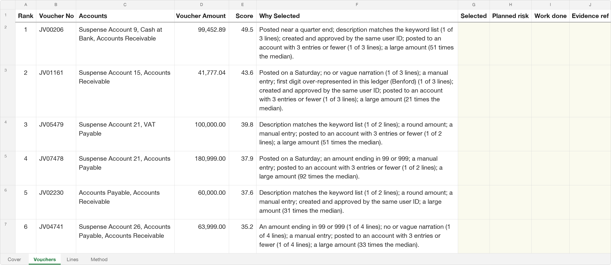
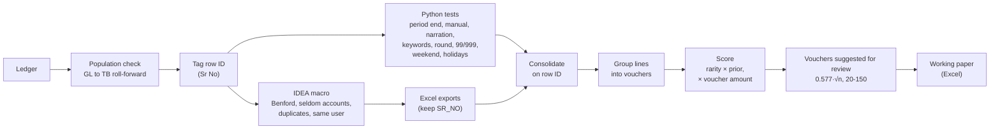
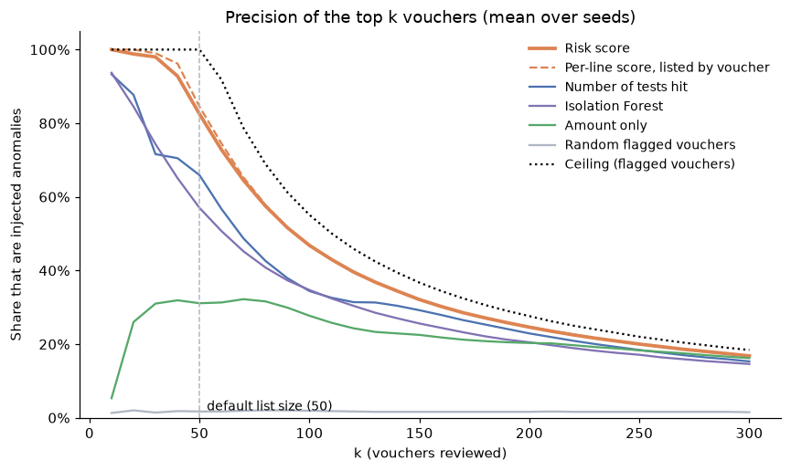

# gl-risk-scoring

[](https://github.com/luke-menezes/gl-risk-scoring/actions/workflows/tests.yml)

[](LICENSE)

**Ranks the journals in a general ledger for audit testing, with the reason for each, on synthetic data.**

- **What it does:** runs simple tests for the journal characteristics ISA 240 points auditors to
  (period-end and manual entries, round amounts, seldom-used accounts, vague narration and more),
  then ranks whole journals with a transparent score, so an audit team can select from the top 50
  instead of thousands of flagged lines.
- **How well:** on 30 synthetic ledgers, 83% of the top 50 journals carry injected anomalies,
  against 66% for counting how many tests each journal meets and 57% for an Isolation Forest. An
  ablation, size sweeps and robustness checks are included, and the results that didn't favour the
  method are reported.
- **What you get:** an Excel working paper with a plain-language reason for each journal and blank
  columns for the auditor's testing, and a tested Python package (CI on Python 3.11 to 3.14).

Built by [Luke Menezes](https://www.linkedin.com/in/luke-j-menezes), audit data analyst. This is a
reduced version, rewritten on synthetic data, of tooling I built at work; that tooling and its data
stay private.

[View the one-page synthetic ledger review](docs/demo_summary.md) or [run the demo](#run-it)
to generate it alongside the Excel working paper.



*The top of the sample working paper ([download](docs/sample_working_paper.xlsx)): each journal's
score, why it was selected, and blank columns for the audit team.*

**Contents:** [Audit context](#audit-context) · [Pipeline](#pipeline) ·
[Key design decisions](#key-design-decisions) · [Results](#results-on-synthetic-data) ·
[The working paper](#the-working-paper) · [Why not a trained model?](#why-not-a-trained-model) ·
[Run it](#run-it) · [What I'd do next](#what-id-do-next)

## The problem

ISA 240 presumes a risk that management overrides controls, for example through false journal
entries, so the auditor must test journal entries whatever their risk assessment. The standard lists
characteristics of entries worth selecting (manual entries, round numbers, seldom-used accounts,
entries with little or no description, and more), and requires selecting entries made at the end of
the period. Simple tests for those characteristics flag thousands of lines: on the synthetic ledgers
here, over a third of the lines meet at least one test. This project combines every test on a row ID
and ranks the journals (vouchers) those lines belong to with a transparent score, because auditors
select and test whole vouchers, and shows why each voucher is on the list. It supports the auditor's
journal entry testing; it doesn't perform it. Selecting entries and concluding on them stay with the
audit team.

**Population first.** Ranking should wait until the population is confirmed complete. Per account,
the opening trial balance plus the ledger's movements must equal the closing trial balance;
`population.roll_forward` returns any difference, which is resolved before testing.

## Audit context

ISA 240 presumes a risk of management override of controls (ISA 240 para 31; ISA 240 (Revised)
para 40), so journal entries are tested whatever the assessed risk (240 para 32(a); 240R paras
47–49). ISA 240 (Revised) applies to periods beginning on or after 15 December 2026 (240R para 16).
The standards list characteristics of entries worth selecting (240 para A43; 240R Appendix 4) but
don't rank them or prescribe tests. Each test here looks for one characteristic or supports the
auditor in another way. "Practical judgement" marks a link that is my judgement rather than the
standard's. Every threshold, window and keyword list is practical judgement. By default the public
holiday test uses the UAE calendar, the weekend is Saturday and Sunday, and ambiguous dates are read
day first (02/03 is 2 March). All of these, with every threshold and word list, are fields of one
`RunSettings` object that the tests and the working paper share, so the cover states exactly what the
tests used.

**Tests that answer a risk**: each lists entries the auditor can select from.

| Test | Characteristic it covers | ISA 240 / ISA 240 (Revised) | Auditor's use |
|---|---|---|---|
| Period end (quarter ends, year-end window) | Entries made at the end of the period | 240 paras 32(a)(ii), A44; 240R paras 49(c), A144 | Select |
| Manual entry | Non-standard and manual entries | 240 para A43; 240R para A144, Appendix 4. Manual as the main filter: practical judgement | Select; also limits the weekend, holiday and round-amount tests to manual lines |
| No or vague narration | Little or no explanation or description | 240 para A43; 240R Appendix 4 | Select |
| Seldom-used account | Entries to seldom-used accounts | 240 para A43; 240R Appendix 4. The 3-entry threshold: practical judgement | Select |
| Rounded amount | Round numbers | 240 para A43; 240R Appendix 4 | Select |
| Ending 99/999 | Consistent ending numbers | 240 para A43; 240R Appendix 4 | Select |
| Keyword match | Entries outside the normal process | 240 para A43; 240R Appendix 4: practical judgement, as is the word list | Select |
| Weekend posting | Outside the normal course of business | 240 para A43; 240R Appendix 4: practical judgement | Select |
| Public holiday | Outside the normal course of business | 240 para A43; 240R Appendix 4: practical judgement | Select |
| Created and approved by the same user | Controls over journal entries (segregation of duties). Whether it is a breach depends on roles and the approval workflow | ISA 315 (Revised 2019) para 26(a)(ii); 240R para 36, Appendix 4 | Select |
| Duplicate | Not an ISA 240 characteristic: a common error and fraud test | Practical judgement | Select |
| Benford entries (lines behind over-represented first digits) | Outliers found with automated tools | 240R para A145: practical judgement | Select |
| Vouchers suggested for review (the score) | A selection aid across the tests above | 240R paras 49(c)–(d), A145: practical judgement. Why each voucher was selected is documented (ISA 230 para 9) | Select |

**Tests that describe the ledger**: planning inputs, not findings.

| Test | What it shows | Reference | Auditor's use |
|---|---|---|---|
| Benford first-digit conformity (MAD) | Whole-ledger analytical screen. Non-conformity is expected where fixed fees or salaries repeat; a spike is a pointer for review, not evidence of error or fraud | ISA 315 para 14(b), A27–A31: practical judgement | Risk assessment input |
| Account summary | Lines and value per account | ISA 315 para 14(b): practical judgement | Risk assessment input |

**Population**

| Test | What it checks | Reference | Auditor's use |
|---|---|---|---|
| GL to TB roll-forward | Journal entry population complete for the period | ISA 500 para 9, A60; 240R paras 49(b), A140 | Population check, before any ranking |

The suggested list is a selection of specific items, not audit sampling (ISA 500 para 10, A52–A56),
so nothing about the unlisted vouchers can be projected from it. Vouchers above performance materiality
(ISA 320 paras 10–11) can be added to it; nothing below clearly trivial (ISA 450 para 5, A2) is
filtered out of any test, because small or split entries can matter.

## Pipeline



## Key design decisions

- **One row ID, tagged before the split.** The ledger gets a running number (`Sr No`) before the
  same file goes to Caseware IDEA and to Python. Every IDEA export keeps it, so the results join
  exactly. A hash of the row wouldn't work: identical duplicate lines would share it. Matching on
  date, account and amount fails for the same reason. See [`idea/README.md`](idea/README.md).
- **Scored per voucher.** Auditors select and test whole journals, so lines are grouped by
  `Voucher No` and a voucher meets a test if any of its lines does. Its amount is the larger of its
  total debits and total credits. Without a voucher column each line is scored on its own, and the
  cover says so.
- **Weight = ledger rarity × prior.** Rarity is `-log10(share of vouchers flagged)`, so a test
  that flags 0.2% of vouchers counts much more than one that flags 12%. The prior carries what the
  test has been worth across past ledgers; the values here are illustrative.
- **Correlated tests count once.** A Saturday that is also a public holiday, or falls in a
  period-end window, is one calendar signal, not two, so only the strongest date test counts for
  each voucher.
- **Manual lines only, where the ledger says which they are.** With a `Source` column, the weekend,
  holiday and round-amount tests count manual lines only, because system postings on a Saturday are
  routine. Without one, the manual-entry test doesn't run and the outputs say so: "manual" is never
  guessed.
- **Gaps are stated, never silent.** A test that can't run for lack of a column, a test run on
  fewer columns than usual (duplicates without a description), and lines whose date or amount
  can't be read are all listed on the working paper's cover. Silence would read as "tested,
  nothing found".
- **Benford scaled by amount diversity.** In ledgers of fixed fees or salaries, non-conformity is
  expected and says little about any one line, so Benford's weight shrinks with the share of
  distinct amounts.
- **Amount as a log multiplier.** `1 + log10(1 + flagged amount / median)`, where the flagged amount
  is the voucher's largest flagged line: large entries rise without a hard cut-off, one rare
  characteristic on a very large entry can still make the list, and a 50-line batch flagged on a few
  small lines isn't lifted by its total.
- **List size grows with √n.** `clip(0.577·√n, 20, 150)` for n vouchers: about 50 for a ledger of
  7,500 vouchers, never more than a reviewer can work through.

**What the benchmark can and can't show.** On the synthetic ledgers, per-ledger rarity and the amount
multiplier clearly earn their place (about 3.5 and 6 points), and sizing the multiplier on the
largest flagged line rather than the whole voucher adds about 4. The illustrative priors add about 1.3
points over rarity alone, within one standard deviation, and the date collapse and the Benford
scaling make no measurable difference. The synthetic data can't test these three: it has no history
for priors to encode, few vouchers where calendar tests stack, and almost no repeated amounts. They
stay because the production tooling has to handle exactly those cases on real ledgers. Scoring per
voucher ranks slightly below scoring lines and listing their vouchers (see below): its value here is
that the list, the rarities and the working paper are in the unit auditors test.

More detail in [`DESIGN.md`](DESIGN.md).

## Results on synthetic data

On synthetic ledgers, the top-50 list of vouchers is 82.5% precise (± 4.6 points over 30 seeds),
against 65.9% for counting how many tests each voucher meets and 57.0% for an Isolation Forest.

Each ledger has about 20,900 lines in about 7,550 balanced vouchers, mostly of 2 to 4 lines, plus
about 20 batch vouchers (payroll and supplier payment runs of 20 to 60 lines) and about 20
double-posted vouchers. 0.8% of the vouchers (about 60) are injected anomalies, all with a larger
amount. These labels exist only in the synthetic data: a real ledger has none. Nine in ten anomalous
vouchers carry one to four signals, each a characteristic a test looks for; the other tenth are
"silent", an unusual amount on a common account on a weekday, from the system, with nothing for any
test to find. Alongside them is normal business that trips the tests anyway: round rent payments,
director fees, a fixed-price supplier, weekend postings, double postings, routine system accruals at
quarter ends, system vouchers with no narration, and batch vouchers in which a few small lines end in
99 or repeat an instalment. The list suggests 50 vouchers. Figures are
per voucher, the mean ± standard deviation over 30 seeds (30 different ledgers), from
`scripts/run_benchmark.py`; every run is in [`docs/benchmark.csv`](docs/benchmark.csv), and the full
tables are in [`docs/benchmark_results.md`](docs/benchmark_results.md).

| Ranking | Precision@50 | Recall@50 |
|---|---|---|
| **Risk score** | **0.825 ± 0.046** | **0.688 ± 0.039** |
| Lines scored on their own, each voucher listed where its first line appears | 0.845 ± 0.048 | 0.704 ± 0.040 |
| Number of tests hit | 0.659 ± 0.056 | 0.549 ± 0.046 |
| Isolation Forest (unsupervised, line features; a voucher's most anomalous line) | 0.570 ± 0.059 | 0.475 ± 0.049 |
| Voucher amount only | 0.311 ± 0.040 | 0.259 ± 0.033 |
| Random flagged vouchers | 0.017 ± 0.017 | 0.014 ± 0.015 |
| Ceiling: best any ranking of flagged vouchers can do | 1.000 | 0.918 ± 0.021 |



How to read the ceiling: recall can't exceed the share of anomalous vouchers with at least one
flagged line, and precision can't exceed that count divided by k. The silent anomalies trip no test
(apart from the odd chance hit on Benford's first digit), so no ranking of flagged vouchers can reach
them and recall tops out at about 0.92. With about 60 anomalous vouchers and a list of 50, recall is
also capped at about 0.83 by the list size. The Isolation Forest ranks the whole ledger, so it could
in principle find silent anomalies through their amount, but it still ranks below the rules-based
scores.

**Per voucher against per line, on the same ledgers.** Scoring the lines on their own and listing
each voucher where its first line appears is slightly more precise than scoring per voucher: 0.845
against 0.825, ahead on 22 of the 30 ledgers, level on 3 and behind on 5. Two things explain it. An
anomalous voucher's line-level signals (a seldom account, a keyword, a round total) sit on its main
line, and the voucher-level ones (date, manual, same user) are on every line, so its best line
already carries nearly everything the voucher does. And a batch voucher meets tests on different
lines by chance (a duplicate on one, a 99 ending on another), which the voucher score adds together
and a line score never does: the voucher-size bias. The batch vouchers were added in 0.8.0 to expose
that weakness, not to flatter the method, and before them the two tied (0.849 and 0.852). Per voucher
is kept because it is the unit auditors select and test, and it makes the rarities and the list count
journals rather than lines.

**Which parts matter.** Switched off one at a time, per-ledger rarity and the amount multiplier are
worth about 3.5 and 6 points, and sizing the multiplier on the largest flagged line rather than the
whole voucher about 4 (ahead on 27 of the 30 ledgers, behind on none): batch vouchers are 0.3% of the
vouchers but 9% of the list, against 18% with the whole-voucher amount. The illustrative priors add
about 1.3 points, within the noise. **Robustness.**
With the generator's own settings drawn at random, the risk score is ahead of counting tests on all
30 ledgers, and about 90% of the list survives every prior being perturbed by up to ±50%.

Ablation, sweeps, robustness checks, the voucher-size check and the old per-line figures:
[docs/benchmark.md](docs/benchmark.md). Every run:
[docs/benchmark_results.md](docs/benchmark_results.md).

### Why each voucher is on the list

`score_flags` adds a `Score Breakdown` column. The top 5 vouchers of the seed-0 list (synthetic
descriptions), as printed by `scripts/make_fixtures.py`:

| Voucher No | Accounts | Lines | Amount | Score | Score Breakdown |
|---|---|---|---|---|---|
| JV00206 | Suspense Account 9, Cash at Bank, Accounts Receivable | 3 | 99,453 | 49.5 | Same User Created and Approved 7.0 + Seldom Account Entries 6.6 + Keyword Match 3.6 + date (Period End) 1.0, × amount 2.71 |
| JV01161 | Suspense Account 15, Accounts Receivable | 3 | 41,777 | 43.6 | Same User Created and Approved 7.0 + Seldom Account Entries 6.6 + No or Vague Narration 2.5 + date (Saturday) 1.3 + Manual Entry 0.8 + Benford 0.3, × amount 2.35 |
| JV05479 | Suspense Account 21, VAT Payable | 2 | 100,000 | 39.8 | Seldom Account Entries 6.6 + Rounded Amount 3.6 + Keyword Match 3.6 + Manual Entry 0.8, × amount 2.72 |
| JV07478 | Suspense Account 21, Accounts Payable | 2 | 180,999 | 37.9 | Seldom Account Entries 6.6 + Ending 99/999 4.0 + date (Saturday) 1.3 + Manual Entry 0.8, × amount 2.97 |
| JV02230 | Accounts Payable, Accounts Receivable | 2 | 60,000 | 37.6 | Same User Created and Approved 7.0 + Rounded Amount 3.6 + Keyword Match 3.6 + Manual Entry 0.8, × amount 2.50 |

In the working paper the same vouchers carry a plain sentence that notes partial hits, for example
JV01161: "Posted on a Saturday; no or vague narration (1 of 3 lines); a manual entry; first digit
over-represented in this ledger (Benford) (1 of 3 lines); created and approved by the same user ID;
posted to an account with 3 entries or fewer (1 of 3 lines); a large amount (21 times the median)."

## The working paper

`export.write_working_paper` writes the vouchers suggested for review as an Excel working paper:
[`docs/sample_working_paper.xlsx`](docs/sample_working_paper.xlsx) is the seed-0 list.

- **Cover**: the status ("entries meeting the test criteria, for the audit team to consider; not
  audit findings"), source, settings, population, whether the list is complete or a top-k cut,
  the tests that couldn't run or ran on fewer columns, lines with an unreadable date or amount, the
  date run, and blank preparer and reviewer.
- **Vouchers**: every listed voucher and the accounts it posted to, with a plain "why selected" sentence next to the score
  breakdown, noting when a test flagged only some of its lines ("a round amount (1 of 3 lines)"),
  and blank columns for the audit team, who test whole vouchers: Selected, Planned risk, Work done,
  Evidence ref, Tested by / date, Auditor's conclusion.
- **Lines**: every line of the listed vouchers, flagged or not, with the tests each line met and the
  period-end window, narration issue and matched keywords in their own columns to filter on.
- **Method**: the weights, marked "Internal to the audit team: not for the client". Selection
  criteria the client can predict weaken the test, and unpredictability is part of the response to
  fraud risk (ISA 240 para 30(c); 240R para 43).

With `performance_materiality` set, vouchers whose amount is above it are listed after the top k,
in addition to it, and labelled; `clearly_trivial` is recorded on the cover and filters nothing.

## Why not a trained model?

- **Real audits have no labels.** Nobody hands the auditor a column saying which entries were
  irregular, so there is nothing to train a supervised model on. The Isolation Forest above needs
  no labels, but it ranks the vouchers below the risk score.
- **Auditors have to explain the selection.** A reviewer must be able to say why a voucher was
  picked, and the score breakdown does that directly. An anomaly score from a model doesn't.
- **Future work: learn the priors.** Testing outcomes (which listed vouchers the audit team found
  to be misstated) are labels. With enough of them, the priors could be learned, for example with a
  logistic regression on the test columns. That isn't done here.

## Run it

```bash
python -m venv .venv && source .venv/bin/activate     # Windows: .venv\Scripts\activate
pip install -e ".[dev,ml]"                             # [ml] adds scikit-learn for the Isolation Forest
#   add -c docs/benchmark-constraints.txt for the exact versions behind the published figures
python scripts/run_demo.py --output-dir demo-output    # writes the working paper and review summary
python -m pytest
jupyter notebook notebooks/demo.ipynb
python scripts/run_benchmark.py                        # about 5 to 30 minutes; --quick for a smoke test
```

The demo generates a synthetic ledger, a matching trial balance and mock IDEA exports in one run.
It writes `working_paper.xlsx` and `review_summary.md` after the checks pass. Reconciliation rejects
unreadable or non-finite amounts while treating blank amount cells as zero. Flag consolidation requires
populated row IDs that stay unique after normalisation, so `001` and `1` cannot both identify different lines.

```python
from glrisk import RunSettings, export, flags, pipeline, population, scoring, synthetic

ledger = synthetic.make_ledger(20_000, seed=0)
amount_cols = synthetic.amount_columns(ledger)
tb = synthetic.make_trial_balance(ledger)
assert population.roll_forward(ledger, tb, amount_cols).attrs["total_difference"] == 0   # population first
settings = RunSettings()            # e.g. RunSettings(holiday_country="GB", dayfirst=False, fy_end_month=3)
lines = flags.consolidate(ledger,
                          pipeline.run_python_tests(ledger, amount_cols, settings),
                          flags.load_idea_flags("fixtures/idea_exports"), min_flags=0)
vouchers = scoring.to_vouchers(lines, amount_cols, settings)   # one row per flagged voucher
suggested = scoring.score_flags(vouchers, ["Voucher Amount"])   # top 0.577·√n vouchers, with Score Breakdown
export.write_working_paper(suggested, lines, "working_paper.xlsx", amount_cols, "Synthetic ledger, seed 0",
                           not_run=pipeline.tests_not_run(ledger, amount_cols, settings), settings=settings)
```

`fixtures/idea_exports` holds mock IDEA exports made from the same seeded ledger
(`scripts/make_fixtures.py`), so everything runs without an IDEA licence. With IDEA, run
[`idea/portfolio_sample.ism`](idea/portfolio_sample.ism) and point `load_idea_flags` at the
project's `Exports.ILB` folder.

## Layout

| Path | Contents |
|---|---|
| `src/glrisk/synthetic.py` | Generator of balanced vouchers with injected anomalies (ground truth), and a matching trial balance |
| `src/glrisk/settings.py` | `RunSettings`: the columns, calendar, thresholds and word lists one run uses, and their cover text |
| `src/glrisk/population.py` | GL to TB roll-forward, per account |
| `src/glrisk/rules.py` | The tests: period end, manual entries, narration, keywords, round, 99/999, day of week, public holidays, duplicates, seldom accounts, same user |
| `src/glrisk/benford.py` | First-digit test, MAD conformity, entries behind over-represented digits |
| `src/glrisk/flags.py` | Flag logs, IDEA export loader, consolidation on the row ID |
| `src/glrisk/scoring.py` | Lines grouped into vouchers, weights, date tests counted once, amount multiplier, list size, materiality, score breakdown |
| `src/glrisk/export.py` | The Excel working paper |
| `src/glrisk/evaluate.py` | Voucher rankings, ceilings, precision and recall at k, multi-seed runs, ablation, robustness and voucher-size checks |
| `src/glrisk/ml_baseline.py` | Isolation Forest baseline (optional `[ml]` extra) |
| `src/glrisk/pipeline.py` | Runs the Python tests, lists the tests that can't run or are limited; computes and writes the mock IDEA exports |
| `src/glrisk/plots.py` | The demo and benchmark charts |
| `scripts/` | Fixture builder, end-to-end demo, and benchmark |
| `docs/` | Benchmark detail ([`benchmark.md`](docs/benchmark.md)) and results, the sample working paper, `images/` |
| `idea/` | IDEAScript sample and the cross-tool design |

## What I'd do next

- **Post-closing entries**, created or edited after the period end, need a created-at column the
  generator doesn't have. With vouchers in place, this is the characteristic the revised standard
  stresses most.
- **Learn the priors from testing outcomes**, once enough tested lists exist (see above).
- **Client-specific baselines**: compare each test's rate with the same client's prior years, not
  only with the current ledger.
- **A content hash key** for matching extracts pulled independently from a client's system, where a
  shared running number isn't possible.

## About this project

The production tooling and all client data stay private, and the scoring priors here are
illustrative. Nothing here is audit advice, and no output is an audit
finding. [`CHANGELOG.md`](CHANGELOG.md) lists the changes by version.

MIT licence.
